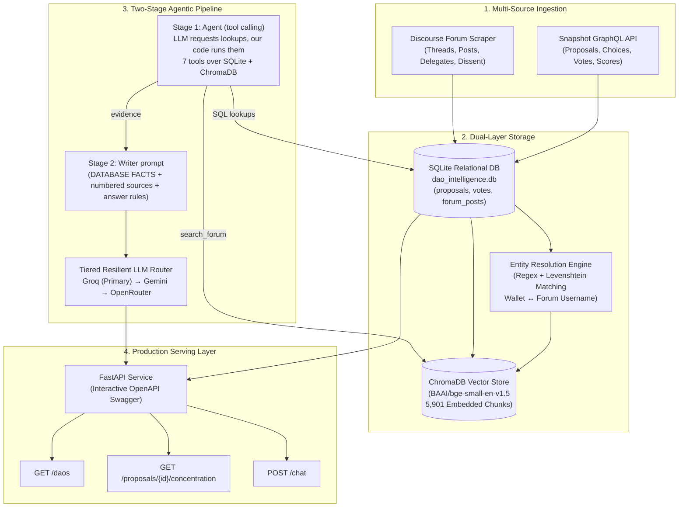

# DAO Governance Intelligence Engine

> **Autonomous multi-source intelligence engine linking on-chain voting power to off-chain forum deliberation across decentralized autonomous organizations (DAOs).**

[](https://www.python.org/)
[](https://fastapi.tiangolo.com/)
[](https://www.trychroma.com/)
[]()
[]()

---

## 1. Executive Summary & Problem Statement

Decentralized governance suffers from a fundamental information asymmetry:
1. **On-Chain Voting (Snapshot / Smart Contracts):** Highly structured, immutable, and exact — but completely silent regarding rationale or deliberation.
2. **Off-Chain Forums (Discourse):** Rich in arguments, dissent, and delegate commitments — but disconnected from actual voting weight.

**The Result:** Proposals pass or fail without transparency into whether the deciding voting power ever engaged with community concerns.

**DAO Governance Intelligence** bridges this divide by joining on-chain voter weight with forum discourse through fuzzy entity resolution, dense vector indexing, and an evaluated Retrieval-Augmented Generation (RAG) pipeline with resilient multi-provider LLM fallback.

---

## 2. Key Empirical Findings (Proven on Real Data)

This system was tested against live data from **5 major DAOs** (Optimism, Arbitrum, Aave, Uniswap, ENS) covering **118 proposals**, **515,000+ on-chain votes** and **2,300+ forum posts** (every vote and every post of each linked thread fetched, not a sample):

> **Scope:** these are the most recent ~20–30 proposals per DAO (118 of the 1,803 these spaces have on Snapshot), each with every vote and every forum post. Optimism's figures cover Nov 2022 – Jan 2023 because that is when Optimism last used Snapshot; its later votes happen elsewhere.

### 📊 The "Silence Gap" (Voters vs. Forum Deliberators)
Across the dataset there are **472 distinct forum participants** against **86,445 distinct voting wallets** — about **0.55%**, fewer than **1%** (an upper bound, since one person can hold several wallets):

| DAO Space | Proposals | Forum Coverage | Avg. Voter-to-Forum Ratio | Key Phenomenon |
|:---|:---:|:---:|:---:|:---|
| **Optimism Collective** (`opcollective.eth`) | 20 | **95.0%** | **0.111%** | 63,845 voters vs. 17 forum posters on election proposals |
| **Arbitrum DAO** (`arbitrumfoundation.eth`) | 24 | **100.0%** | **1.272%** | High community discussion, small voting cohort |
| **Aave DAO** (`aavedao.eth`) | 31 | **100.0%** | **6.853%** | Strict forum mandate before on-chain execution |
| **Uniswap** (`uniswapgovernance.eth`) | 22 | **90.9%** | **4.501%** | Heavy reliance on off-chain delegate statements |
| **ENS** (`ens.eth`) | 20 | **90.0%** | **11.626%** | Small, active technical community |

*Forum coverage = share of proposals with at least one forum post. The ratio is the average over proposals of forum posters ÷ voters, so a proposal with very few voters moves it a lot (e.g. Aave fell from 15.6% when one proposal grew from 1 voter). Earlier versions counted only the first 20 posts of each thread; these figures use every post.*

### 🐋 Whale Power Concentration
Measured on complete vote data (116 proposals with votes), the share of voting power held by the largest wallets is:
* **Median top-4 wallets: 53.7%** of voting power; **median top-10 wallets: 86.8%**.
* **Optimism mass elections** (12,000–64,000 voters each) sit at **45–55%** for the top 4 — e.g. Badgeholder Nomination 54.5%, Velodrome 46.8%, Cycle #9a Grants Council 47.7%.
* **Small, delegate-driven Uniswap votes are the most concentrated**: top-4 wallets hold 99.7% (sentinel rotation, 383 voters) and 98.4% (governance statute RFC, 133 voters).

> **Correction:** earlier versions of this README reported 87–94% top-4 concentration and a ~82% median. Those figures came from a capped sample (the first 500–1,000 votes of each proposal, because Snapshot limits one request to 1,000), which overstated concentration on large votes. The numbers above use every vote.

---

## 3. System Architecture

For a file-by-file view of ingestion, storage, indexing, retrieval, and API
data movement, see [`DATA_FLOW.md`](./DATA_FLOW.md).



---

## 4. Quantitative Evaluation (RAG Triad)

To validate the retrieval and generation pipeline, an automated evaluation harness (`eval/eval_harness.py`) was run against a golden ground-truth benchmark (`eval/golden_dataset.py`) evaluated via an LLM judge:

| Metric | Score | Industry Benchmark | What It Proves |
|:---|:---:|:---:|:---|
| **Answer Relevancy** | **1.00 (100%)** | > 0.85 | 100% of answers directly answered the user's governance question without drift. |
| **Faithfulness** | **0.90 (90%)** | > 0.80 | 90% of claims made in generated responses were strictly supported by cited source chunks. |
| **Context Recall** | **0.87 (87%)** | > 0.75 | 87% of ground-truth reference chunks were successfully surfaced in the top-5 vector search. |
| **Context Precision** | **0.21** | — | Top-5 retrieval scoping keeps prompt token count within free-tier limits while capturing ground-truth. |

> **These four scores were measured on an earlier version of the pipeline** (vector search picked the
> facts). The chat is now a two-stage agent (see section 6); refresh them with
> `python -m eval.eval_harness --judge` before quoting them. The exact-check golden dataset
> (38 cases, `python -m eval.eval_harness`) is the current benchmark.

---

## 5. API Reference & Live Endpoints

The API is served with FastAPI at `http://127.0.0.1:8000`. Interactive documentation is available at **`/docs`**.

### Endpoints Overview

| Method | Endpoint | Query / Body Params | Description |
|:---|:---|:---|:---|
| `GET` | `/` | None | Service status and every registered endpoint (generated from the API schema). |
| `GET` | `/daos` | None | All 5 DAOs with forum coverage, average silence ratio and average winning-choice share. |
| `GET` | `/daos/{space_id}` | `space_id` (path) | One DAO with its 5 most-voted proposals. |
| `GET` | `/proposals` | `space_id`, `state`, `limit` (1-100), `skip` | Filterable proposal list with silence ratio and winning share. |
| `GET` | `/proposals/{id}` | `proposal_id` (path) | Proposal detail: body preview, choices, scores, stored vote count. |
| `GET` | `/proposals/{id}/concentration` | `top_n` (1-50, default 4) | Whale report: top-N wallets, their share of voting power and their choices (as names). |
| `POST` | `/chat` | `{"query": str, "proposal_id": opt, "n_results": 5}` | Q&A with cited sources (each forum passage with its author's wallet and vote), the database lookups the agent made, and which LLM answered. |
| `GET` | `/sync/status` | None | What data is stored, how fresh it is, and vote / forum completeness. |
| `POST` | `/sync/run` | `limit` (1-50, default 10) | Run the sync now: proposals, forum threads, votes. |
| `GET` | `/identities/stats` | None | How many forum users and posts are linked to wallets. |
| `GET` | `/identities` | `q`, `min_confidence`, `method`, `limit`, `offset` | Search forum-user → wallet links. |
| `GET` | `/identities/proposal/{id}` | `proposal_id` (path) | Every forum poster of a proposal with wallet, confidence, voting power and choice. |
| `GET` | `/identities/wallet/{address}` | `wallet_address` (path) | Which forum user(s) a wallet belongs to. |
| `GET` | `/identities/{username}` | `username` (path) | One user's wallet, ENS name, post count and largest votes. |
| `POST` | `/identities/resolve` | `profile_limit`, `voter_wallets` | Run all wallet-linking strategies in the background. |
| `GET` | `/identities/resolve/status` | None | Progress of that background run. |

Vote choices are always returned as **names** (`"For"`, ranked `["Against", "For"]`,
weighted `{"For": 2}`), never as Snapshot's raw numbers.

### Sample `POST /chat` Payload & Response

**Request:**
```bash
curl -X POST "http://127.0.0.1:8000/chat" \
     -H "Content-Type: application/json" \
     -d '{
       "query": "Why did delegates vote to ban Good Entry in the Watchdog Program?",
       "proposal_id": "0x472fb3b40d3df9b1a65de03b85e4867a76f7b1ec014e2d69f347256b0d08184c"
     }'
```

**Response:**
```json
{
  "query": "Why did delegates vote to ban Good Entry in the Watchdog Program?",
  "proposal_id": "0x472fb3b40d3df9b1a65de03b85e4867a76f7b1ec014e2d69f347256b0d08184c",
  "provider": "groq",
  "chunks_found": 5,
  "answer": "Delegates voted to permanently ban Good Entry based on the findings from the Watchdog Program regarding high-severity misuse of grant funds [Source 1, Source 2]. Furthermore, delegates noted that Good Entry failed to respond or communicate in the public forum during the official response window [Source 4, Source 5].",
  "sources": [
    {
      "id": "proposal_0x472fb3b40d3df9b1a65de03b85e4867a76f7b1ec014e2d69f347256b0d08184c_0",
      "source_type": "proposal_body",
      "distance": 0.384,
      "author": null
    },
    {
      "id": "forum_post_78189",
      "source_type": "forum_post",
      "distance": 0.412,
      "author": "Zeptimus"
    }
  ]
}
```

---

## 6. Engineering Decisions & Architecture Trade-offs

1. **Why SQLite for Relational Ingestion instead of Postgres?**
   * *Rationale:* The ingestion pipeline is write-infrequent (batch Snapshot & Discourse sync) and read-heavy. SQLite provides sub-millisecond local reads with zero infrastructure overhead. It currently runs in its default rollback-journal mode; enabling WAL (Write-Ahead Logging) would let API reads continue while a sync is writing. Per-request connections with clean context teardown prevent connection leaks while keeping the data layer trivial to migrate to PostgreSQL.
2. **Why Local ChromaDB PersistentClient?**
   * *Rationale:* Avoids distributed network hops for vector search. Using `BAAI/bge-small-en-v1.5` embeddings (384 dimensions) provides high semantic density and fast Euclidean/cosine distance calculations while fitting comfortably in memory.
3. **Why a Multi-Tier Resilient LLM Router?**
   * *Rationale:* Free-tier inference providers enforce strict TPM (Tokens Per Minute) and RPM limits (e.g. Groq 8,000 TPM on large models). The engine implements a tiered fallback:
     $$\text{Groq (Ultra-Low Latency)} \xrightarrow{429 / \text{Error}} \text{Google Gemini} \xrightarrow{\text{Fail}} \text{OpenRouter}$$
   * Ensures uninterrupted service even during peak rate-limiting events.
4. **Chunking sized to the embedding model, not to taste:**
   * *Rationale:* `BAAI/bge-small-en-v1.5` reads at most 512 tokens and silently ignores the rest. Long forum posts used to be embedded whole, so 46.8% of all forum text was invisible to search. Proposal bodies (paragraph packing, 1,500 characters) and forum posts (sentence splitting, 1,200 characters) are now cut so that every chunk fits, with a token-level cap (500) that catches URLs and tables. See `vector/chunking.py`.
5. **Distance Filtering (0.70 anywhere, 0.85 inside one proposal, 1.0 for one author):**
   * *Rationale:* Standard vector search returns the top $K$ items regardless of quality. A cosine distance ceiling keeps irrelevant chunks out of the prompt. Measured on real data, a descriptive sentence lands at 0.45-0.6 and a single keyword at 0.7-0.95, so the ceiling is loosest where the search is already narrowed to one proposal or author, and the agent is told to write full-sentence queries.
6. **Tool calling instead of "guess the facts from search results":**
   * *Rationale:* Vector search finds similar *text*; it cannot rank ("most voters"), count, or find "what griff voted". The old pipeline gave the LLM facts for whichever 2-3 proposals search happened to return, and the model ranked those as if they were everything (it answered 1,019 voters when the maximum is 63,845). Now the LLM only *chooses* among seven lookups (`features/chat/tools.py`); our tested code runs them, so every number comes from the same functions as the API. A second, separate LLM call writes the single final answer from that evidence, under the citation rules. Frameworks (LangChain, LlamaIndex) offer text-to-SQL, but their SQL is written by the model; here the model never writes SQL and our metric definitions (silence ratio, "closest vote") stay fixed.

---

## 7. Code Guide

> **New here? Start with [`GUIDE.md`](./GUIDE.md)** — a one-read map: one chat question
> followed file by file, how data gets in, where every rule lives, the tables, commands,
> and "where do I change…?".

### How the code is organised
One folder per feature; inside it, `routes.py` is the HTTP layer, `service.py` the
queries, `fetch.py` the download from outside services, and `completeness.py` the
"do we have everything?" rule. A file-by-file map is in [`DATA_FLOW.md`](./DATA_FLOW.md).

```
main.py            creates the API and registers one router per feature
config/            the DAOs we follow
db/schema.py       every table, and get_connection() (the only way to open the database)
clients/           the only code that talks to the internet: Snapshot, Discourse, ENS
features/
  metrics.py       every governance number, defined once
  proposals/ votes/ forum/ daos/ sync/ identity/ chat/
vector/            the ChromaDB search index (chunking + incremental sync)
eval/              the evaluation harness and its golden dataset
tests/             offline tests and regression checks on the real database
```

### How every file is documented
So you can open any file and follow it without reading the rest of the project:

- **Header** — what the file does, where it sits in the flow (who calls it, what it calls), and its inputs.
- **Every function** — what it returns and *where each parameter comes from*
  (e.g. "`limit` — sync_all passes 20; the CLI passes `--limit`").
- **End of file: "Where control goes next"** — the file that usually runs next, and what
  happens *if* something goes wrong (a failed request, an unknown id) or the file is run on its own.

### One home for every rule
Rules that several parts of the system depend on are written exactly once:

| Rule | Lives in | Used by |
|:---|:---|:---|
| Forum posters, silence ratio, winning share, top-voter share, choice names | `features/metrics.py` | DAO endpoints, proposal endpoints, chat |
| Is a proposal's vote data complete? | `features/votes/completeness.py` | vote fetcher, audit, whale share |
| Is a forum thread's data complete? | `features/forum/completeness.py` | forum fetcher, audit |
| The chat pipeline (agent picks lookups → evidence → writer prompt → LLM) | `features/chat/service.py` `run_chat` | `POST /chat`, the terminal chat and the evaluation |
| Which lookups the LLM may request | `features/chat/tools.py` | the agent (`features/chat/agent.py`) |
| Paging through Snapshot by time | `clients/snapshot.py` `_iter_by_created` | votes and proposals |

So the endpoints and the chat can never report different numbers for the same thing,
and the evaluation always measures the pipeline users actually get.

### Suggested reading order
Follow each file's "Where control goes next" section:

1. **A chat request** — `main.py` → `features/chat/routes.py` → `service.py` → `agent.py` → `llm.py`
   (`generate_with_tools`) → `tools.py` → `retrieval.py` / `context.py` → `features/metrics.py`
   → back in `service.py` → `prompt.py` → `llm.py` (`generate`)
2. **Keeping the data fresh** — `features/sync/runner.py` → `proposals/fetch.py`
   → `forum/fetch.py` → `votes/fetch.py` → `sync/audit.py`
3. **Linking forum users to wallets** — `features/identity/runner.py` → `strategies/*.py` → `common.py`
4. **The search index** — `vector/embedding.py` → `vector/chunking.py`

---

## 8. Quickstart & Installation

### Prerequisites
* Python 3.11+
* Git

### Setup
```bash
# Clone repository
git clone https://github.com/Rakshitgoyal770/DOA-BACKEND.git
cd DOA-BACKEND

# Create and activate virtual environment
python -m venv .venv
.\.venv\Scripts\activate       # Windows
# source .venv/bin/activate    # Linux / macOS

# Install dependencies
pip install -r requirements.txt
```

### Environment Configuration (`.env`)
```ini
GROQ_API_KEY=your_groq_key
GEMINI_API_KEY=your_gemini_key
OPENROUTER_API_KEY=your_openrouter_key
```

### Running the API
```bash
uvicorn main:app --port 8000 --reload
```
Navigate to `http://127.0.0.1:8000/docs` to test endpoints via Swagger.

### Keeping the Data Fresh
Run these in order after new governance activity (each step only processes what changed):
```bash
python -m features.sync.runner --sync-all     # proposals, forum posts, every missing vote
python -m features.identity.runner --upgrade  # re-check wallet links (offline)
python -m vector.embedding                    # embed only new/changed documents
python -m features.sync.runner --check        # audit, including vote completeness
```

### Running the Tests
```bash
python -m pytest
```
Offline unit tests use a temporary database and fakes; `tests/test_regression_real_db.py`
pins verified values from the real database and is skipped when it is absent.

### Running the Evaluation Harness
```bash
python -m eval.eval_harness
```
The harness runs the same `run_chat` pipeline as `POST /chat`, so it is ready for Phase 2: measuring the chat quality baseline.

### Reading the Code
Every file starts with what it does and where it sits, and ends with a "Where control goes next" section. Follow those notes in this order to trace one request from start to finish:

```
main.py → features/chat/routes.py → service.py → agent.py → tools.py → (retrieval.py, context.py, metrics.py) → prompt.py → llm.py
```

Then the data side:

```
features/sync/runner.py → proposals/fetch.py → forum/fetch.py → votes/fetch.py
```

---

## 9. SDE Resume Bullet Points

You can copy and adapt these bullet points directly for software engineering and backend roles:

* **Backend / Distributed Systems:**
  > *“Engineered a production-ready governance intelligence backend using FastAPI, SQLite, and ChromaDB, ingesting 118 proposals and 515,000+ votes across 5 DAOs from Snapshot GraphQL and Discourse APIs.”*

* **Machine Learning / RAG:**
  > *“Architected an evaluated RAG pipeline with dense vector indexing (BAAI/bge-small-en-v1.5) and a 3-tier resilient LLM fallback router (Groq &rarr; Gemini &rarr; OpenRouter) with automatic 429 backoff handling.”*

* **Evaluation & Impact:**
  > *“Benchmarked retrieval quality using an automated LLM-as-a-judge evaluation harness over a golden dataset, achieving 87% Context Recall, 90% Faithfulness, and 100% Answer Relevancy.”*

* **Data Engineering & Analytics:**
  > *“Conducted whale concentration and voter silence analysis on Snapshot governance, measuring that the median top-4 wallets control ~54% of voting power (top-10: ~87%) while <1% of voting wallets participate in forum deliberation.”*
