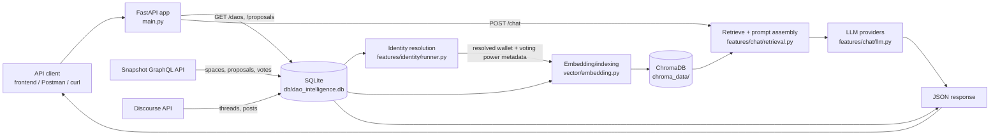
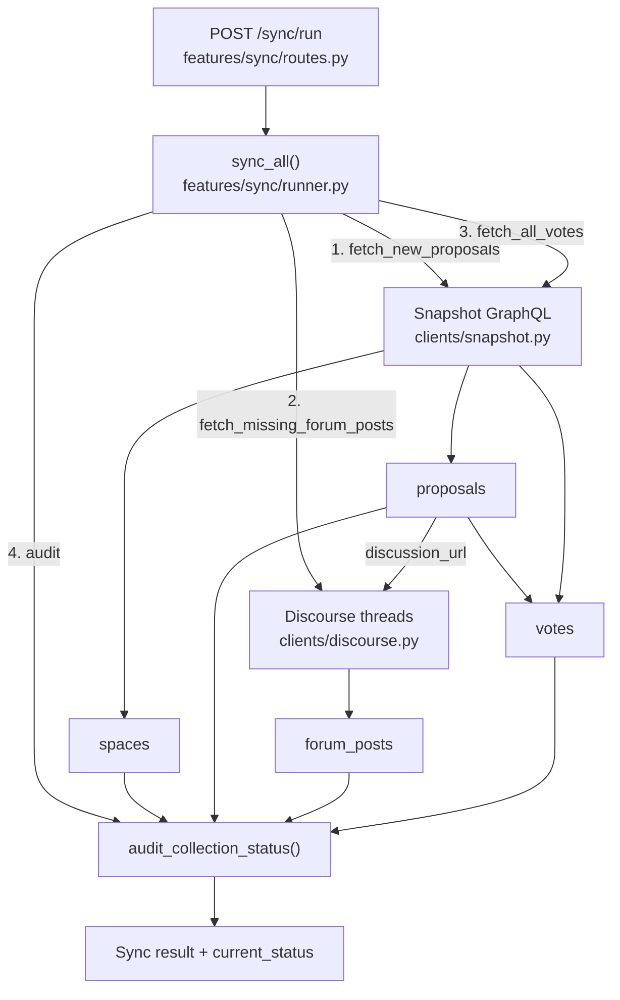
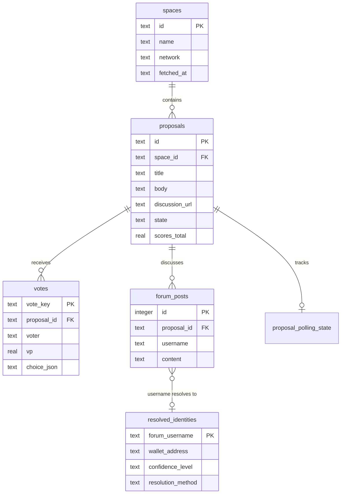
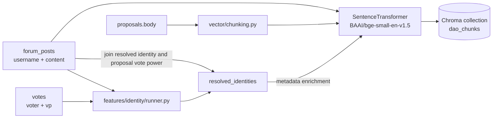
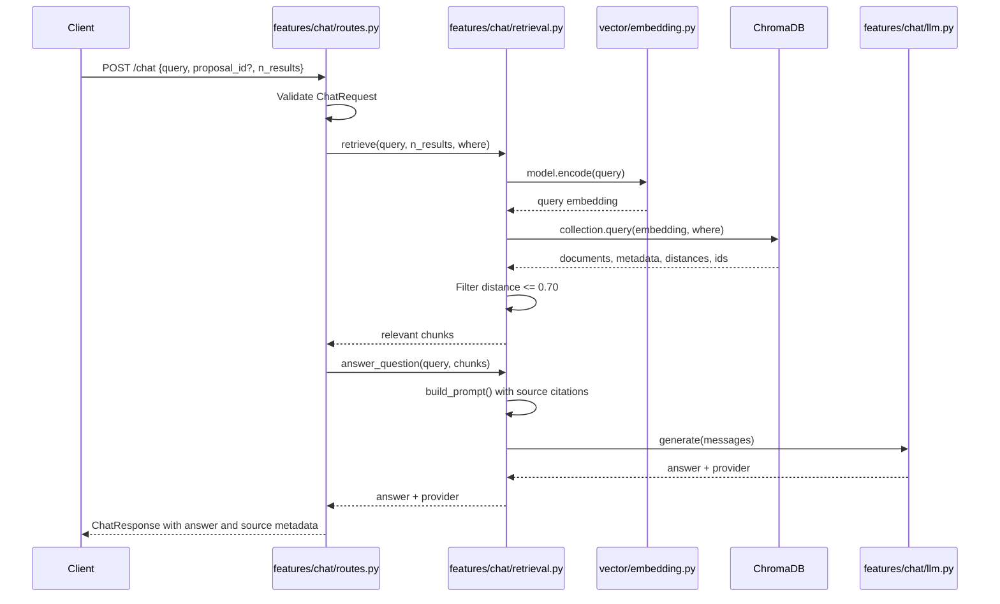
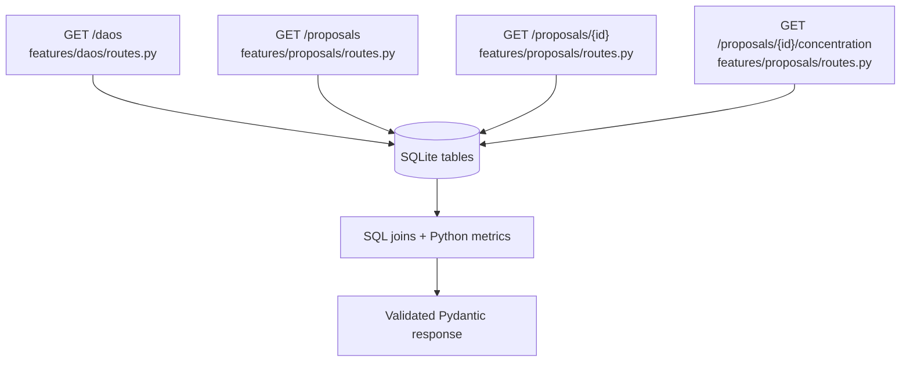

# DAO Governance Intelligence — File-Mapped Data Flow

This document maps the runtime data flow to the source files in this
repository. It covers the two primary paths:

1. **Ingestion and synchronization:** external governance data is collected,
   normalized, stored in SQLite, and made available for indexing.
2. **Query and analysis:** API requests read structured data or retrieve
   semantically relevant context from ChromaDB before generating an answer.

## Project structure

One folder per feature; each feature keeps its HTTP routes, logic and fetching together.

```
main.py                    app creation + router registration only
config/                    curated DAO list
db/                        schema + connection (dao_intelligence.db lives here)
clients/                   external APIs only: snapshot.py, discourse.py, ens.py
features/
  proposals/               routes.py (API)  fetch.py (pull from Snapshot)
  votes/                   fetch.py (capped + full cursor-paged fetch)
  forum/                   fetch.py (Discourse posts)
  daos/                    routes.py
  sync/                    routes.py  audit.py  runner.py (CLI: python -m features.sync.runner)
  identity/                routes.py  runner.py  stats.py  common.py  strategies/*
  chat/                    routes.py  retrieval.py  context.py  prompt.py  service.py  llm.py
vector/                    chunking.py  embedding.py (ChromaDB index)
eval/                      RAG evaluation harness
scripts/                   manual one-off checks
```

## System-level flow



## 1. Application startup and routing

| Stage | File | Responsibility |
|---|---|---|
| Application creation | [`main.py`](./main.py) | Creates the FastAPI app, enables CORS, registers all routers, and initializes SQLite on startup. |
| Database initialization | [`db/schema.py`](./db/schema.py) | Creates tables, indexes, and per-request SQLite connections. |
| DAO endpoints | [`features/daos/routes.py`](./features/daos/routes.py) | Reads `spaces`, `proposals`, and `forum_posts` to return DAO summaries and top-proposal statistics. |
| Proposal endpoints | [`features/proposals/routes.py`](./features/proposals/routes.py) | Reads proposal, vote, and forum data; computes silence and voting-power concentration metrics. |
| Chat endpoint | [`features/chat/routes.py`](./features/chat/routes.py) | Validates the request, invokes retrieval and answer generation, and returns cited source chunks. |
| Sync endpoints | [`features/sync/routes.py`](./features/sync/routes.py) | Exposes collection audits and full incremental synchronization. |

## 2. External-data ingestion flow



### Ingestion file mapping

- [`features/proposals/fetch.py`](./features/proposals/fetch.py), [`features/forum/fetch.py`](./features/forum/fetch.py),
  [`features/votes/fetch.py`](./features/votes/fetch.py), [`features/sync/audit.py`](./features/sync/audit.py),
  [`features/sync/runner.py`](./features/sync/runner.py)
  - `fetch_new_proposals()` gets current proposals for every curated DAO and
    upserts proposal state, scores, and counts.
  - `fetch_missing_forum_posts()` selects proposals with a discussion URL but
    no stored posts, fetches the thread, and upserts `forum_posts`.
  - `fetch_all_votes()` ([`features/votes/fetch.py`](./features/votes/fetch.py))
    downloads every vote for proposals whose votes are missing or partial,
    resuming from the newest stored vote, and upserts `votes` (no cap).
  - `vote_completeness()` ([`features/votes/completeness.py`](./features/votes/completeness.py))
    is the single rule for "complete / partial / missing", shared by the
    fetcher and the audit.
  - `audit_collection_status()` calculates collection ranges, missing-data
    counts and vote completeness from SQLite.
  - `sync_all()` runs the three ingestion stages and returns the final audit.

- [`clients/snapshot.py`](./clients/snapshot.py) translates
  Snapshot GraphQL responses into spaces, proposals, and votes.
- [`clients/discourse.py`](./clients/discourse.py) fetches
  Discourse JSON, strips HTML, and extracts normalized posts.

## 3. SQLite data model



The schema is defined in [`db/schema.py`](./db/schema.py). The database file
is `db/dao_intelligence.db`; all API and ingestion modules use
`get_connection()` rather than opening the database independently.

## 4. Identity resolution and vector indexing



- [`features/identity/runner.py`](./features/identity/runner.py) stores
  wallet-to-forum mappings discovered through self-disclosure, ENS names, or a
  manually verified registry.
- [`vector/embedding.py`](./vector/embedding.py) syncs ChromaDB with SQLite
  incrementally: new or edited text is embedded, metadata-only changes are
  updated without embedding, removed rows are deleted, everything else is
  skipped (`python -m vector.embedding [--dry-run]`).
- Proposal documents are split by
  [`vector/chunking.py`](./vector/chunking.py); forum posts are indexed as
  individual documents.
- Forum metadata can include `resolved_wallet`, `confidence_level`, and
  proposal-specific `voting_power`.

## 5. `POST /chat` query flow



Important behavior:

1. An optional `proposal_id` becomes a Chroma metadata filter.
2. Retrieval requests up to `n_results` chunks and removes chunks whose
   distance is greater than `0.7`.
3. If no chunks remain, [`features/chat/routes.py`](./features/chat/routes.py) returns
   HTTP 404 rather than calling an LLM without context.
4. [`features/chat/llm.py`](./features/chat/llm.py) tries providers in this
   order: Groq, Gemini, OpenRouter, then Mistral.
5. The response preserves the retrieved document, source type, proposal ID,
   author, voting power, and distance for traceability.

## 6. Structured analytics flow



- `routes_dao.py` calculates forum coverage, average silence ratio, and
  winning-choice share from proposal/forum joins.
- `routes_proposal.py` returns proposal details and calculates the silence
  ratio from `forum_posters / votes_count`.
- The concentration endpoint orders `votes.vp` descending and calculates the
  combined share of the top `N` voters.

## 7. File-to-data ownership summary

| Data or transformation | Primary file(s) |
|---|---|
| FastAPI app and router registration | [`main.py`](./main.py) |
| Schema and SQLite connections | [`db/schema.py`](./db/schema.py) |
| Snapshot spaces/proposals/votes | [`clients/snapshot.py`](./clients/snapshot.py), [`features/sync/runner.py`](./features/sync/runner.py) |
| Discourse threads/posts | [`clients/discourse.py`](./clients/discourse.py), [`features/forum/fetch.py`](./features/forum/fetch.py) |
| Identity matching | [`features/identity/runner.py`](./features/identity/runner.py) |
| Proposal chunking and embeddings | [`vector/chunking.py`](./vector/chunking.py), [`vector/embedding.py`](./vector/embedding.py) |
| Vector retrieval and prompt assembly | [`features/chat/retrieval.py`](./features/chat/retrieval.py) |
| LLM fallback routing | [`features/chat/llm.py`](./features/chat/llm.py) |
| DAO analytics | [`features/daos/routes.py`](./features/daos/routes.py) |
| Proposal analytics | [`features/proposals/routes.py`](./features/proposals/routes.py) |
| Natural-language Q&A | [`features/chat/routes.py`](./features/chat/routes.py) |
| Sync and freshness audit API | [`features/sync/routes.py`](./features/sync/routes.py) |

