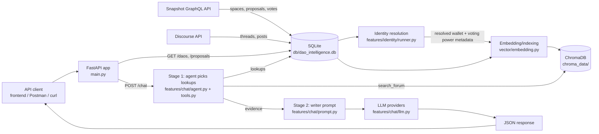
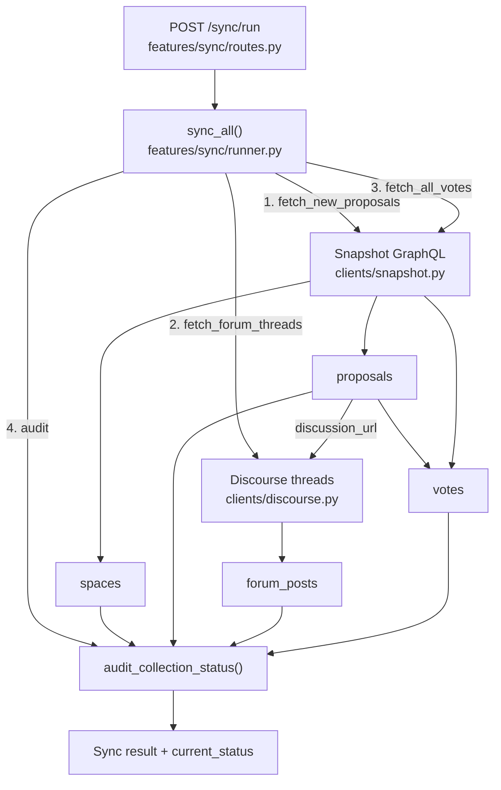
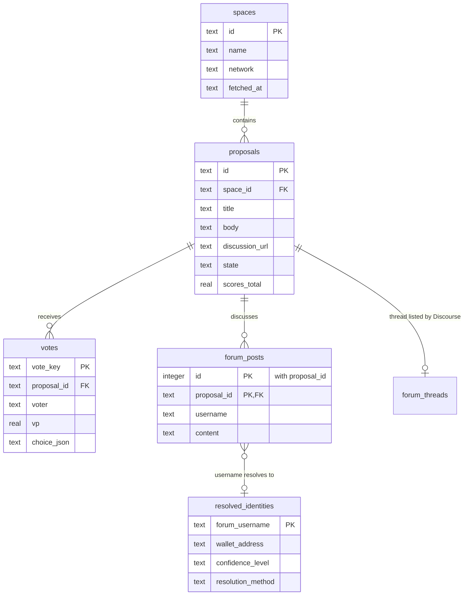
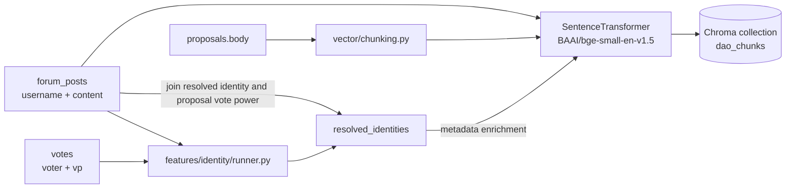
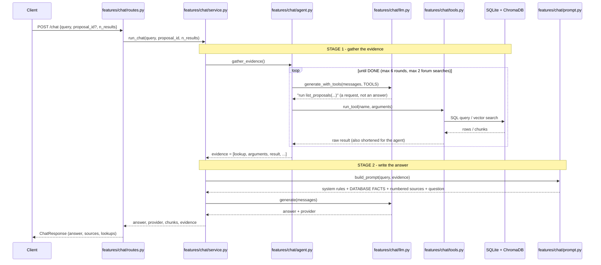
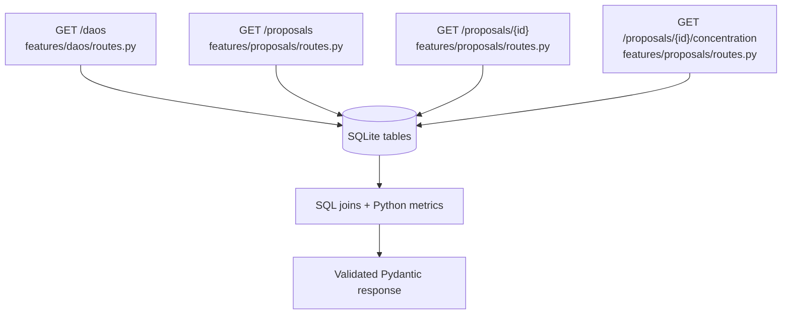

# DAO Governance Intelligence — File-Mapped Data Flow

This document maps the runtime data flow to the source files in this
repository. It covers the two primary paths:

1. **Ingestion and synchronization:** external governance data is collected,
   normalized, stored in SQLite, and made available for indexing.
2. **Query and analysis:** API requests read structured data or retrieve
   semantically relevant context from ChromaDB before generating an answer.

## Project structure

One folder per feature; each feature keeps its HTTP routes, logic and fetching together.
Every file starts with a header (what it does, where it sits, its inputs), every
function says where its parameters come from, and every file ends with a
"Where control goes next" section.

```
main.py                    app creation + router registration only
config/                    curated DAO list
db/                        schema + connection (dao_intelligence.db lives here)
clients/                   external APIs only: snapshot.py, discourse.py, ens.py
features/
  metrics.py               every governance number, defined once (silence ratio,
                           winning share, top-voter share, choice names)
  proposals/               routes.py (API)  service.py (queries)  fetch.py (Snapshot sync)
  votes/                   fetch.py (complete cursor-paged fetch)  completeness.py (the rule)
  forum/                   fetch.py (every post of each thread)  completeness.py (the rule)
  daos/                    routes.py  service.py
  sync/                    routes.py  audit.py  runner.py (CLI: python -m features.sync.runner)
  identity/                routes.py  runner.py  stats.py  common.py  strategies/*
  chat/                    routes.py  service.py (run_chat: gather evidence, then write)
                           agent.py (stage 1)  tools.py (the 7 lookups)  retrieval.py
                           context.py  prompt.py (stage 2)  llm.py  cli.py (terminal chat)
vector/                    chunking.py  embedding.py (ChromaDB index, incremental)
eval/                      RAG evaluation harness (uses run_chat, like the API)
tests/                     offline tests + regression checks on the real database
```

## System-level flow



## 1. Application startup and routing

| Stage | File | Responsibility |
|---|---|---|
| Application creation | [`main.py`](./main.py) | Creates the FastAPI app, enables CORS, registers all routers, and initializes SQLite on startup. |
| Database initialization | [`db/schema.py`](./db/schema.py) | Creates tables, indexes, and per-request SQLite connections. |
| DAO endpoints | [`features/daos/routes.py`](./features/daos/routes.py) | Reads `spaces`, `proposals`, and `forum_posts` to return DAO summaries and top-proposal statistics. |
| Proposal endpoints | [`features/proposals/routes.py`](./features/proposals/routes.py) | Reads proposal, vote, and forum data; computes silence and voting-power concentration metrics. |
| Chat endpoint | [`features/chat/routes.py`](./features/chat/routes.py) | Validates the request, runs the two-stage chat pipeline, and returns the answer with its source passages and the lookups made. |
| Sync endpoints | [`features/sync/routes.py`](./features/sync/routes.py) | Exposes collection audits and full incremental synchronization. |

## 2. External-data ingestion flow



### Ingestion file mapping

- [`features/proposals/fetch.py`](./features/proposals/fetch.py), [`features/forum/fetch.py`](./features/forum/fetch.py),
  [`features/votes/fetch.py`](./features/votes/fetch.py), [`features/sync/audit.py`](./features/sync/audit.py),
  [`features/sync/runner.py`](./features/sync/runner.py)
  - `sync_proposals()` ([`features/proposals/fetch.py`](./features/proposals/fetch.py))
    re-reads every unfinished proposal (active, or scores not final) by id,
    then adds every proposal published since the newest one stored, paging
    by creation time. A row is rewritten only when a field changed.
  - `fetch_forum_threads()` ([`features/forum/fetch.py`](./features/forum/fetch.py))
    fetches every post of each linked thread (Discourse's first page holds only
    20; the rest are requested by id), stores posts once per proposal linking
    the thread, and re-checks recent threads for new posts.
  - `forum_completeness()` ([`features/forum/completeness.py`](./features/forum/completeness.py))
    compares stored posts with what Discourse listed (`forum_threads`).
  - `fetch_all_votes()` ([`features/votes/fetch.py`](./features/votes/fetch.py))
    downloads every vote for proposals whose votes are missing or partial,
    resuming from the newest stored vote, and upserts `votes` (no cap).
  - `vote_completeness()` ([`features/votes/completeness.py`](./features/votes/completeness.py))
    is the single rule for "complete / partial / missing", shared by the
    fetcher and the audit.
  - `audit_collection_status()` calculates collection ranges, missing-data
    counts and vote completeness from SQLite.
  - `sync_all()` runs the three ingestion stages and returns the final audit.

- [`clients/snapshot.py`](./clients/snapshot.py) translates
  Snapshot GraphQL responses into spaces, proposals, and votes.
- [`clients/discourse.py`](./clients/discourse.py) fetches
  Discourse JSON, strips HTML, and extracts normalized posts.

## 3. SQLite data model



The schema is defined in [`db/schema.py`](./db/schema.py). The database file
is `db/dao_intelligence.db`; all API and ingestion modules use
`get_connection()` rather than opening the database independently.

## 4. Identity resolution and vector indexing



- [`features/identity/runner.py`](./features/identity/runner.py) stores
  wallet-to-forum mappings discovered through self-disclosure, ENS names, or a
  manually verified registry.
- [`vector/embedding.py`](./vector/embedding.py) syncs ChromaDB with SQLite
  incrementally: new or edited text is embedded, metadata-only changes are
  updated without embedding, removed rows are deleted, everything else is
  skipped (`python -m vector.embedding [--dry-run]`).
- Both proposal bodies and forum posts are split by
  [`vector/chunking.py`](./vector/chunking.py) so no chunk exceeds the embedding
  model's 512-token limit (proposals: paragraphs packed to 1,500 characters;
  forum posts: split by sentence to 1,200 characters when they do not fit; both
  also capped at 500 tokens). A post that fits keeps its single document; a
  longer one becomes several (`_c0`, `_c1`, ...). See the header of that file for the reasoning.
- Forum metadata can include `resolved_wallet`, `confidence_level`, and
  proposal-specific `voting_power`.

## 5. `POST /chat` query flow

The pipeline has two stages and produces ONE answer. The LLM never touches the database: in
stage 1 it can only *request* lookups by name; our code runs them.



Important behavior:

1. The seven lookups ([`features/chat/tools.py`](./features/chat/tools.py)): `find_proposals`,
   `list_proposals`, `dao_stats`, `proposal_details`, `top_voters`, `person`, `search_forum`.
   Numbers come from the same code as the API endpoints ([`features/metrics.py`](./features/metrics.py)).
2. If the user selected a proposal (`proposal_id`), lookups that take one use it whenever the model
   leaves it out.
3. `search_forum` embeds the query and asks ChromaDB for the nearest chunks. A passage is dropped when
   its distance exceeds 0.7 (searching everywhere), 0.85 (inside one proposal) or 1.0 (one author's
   posts). Every forum passage comes with its author's wallet and how that wallet voted.
4. The agent may run at most 6 rounds and 2 forum searches, and a repeated lookup is skipped.
   **Safety net:** if the question asks for reasons or opinions (why, argued, concerns, said, feel, what
   a proposal asks for ...) and the agent ran no forum search, `gather_evidence` runs one itself with
   the question as written (4 passages, inside the selected proposal when there is one). It is marked
   `automatic` in the evidence and in `/lookups`. Counts ("how many ...") never trigger it, and a
   distance or reranker score is not used as the trigger (tested: it passed passages for number
   questions and blocked on-topic ones).
5. Counts (voters, forum posters) come from `proposal_details` / `dao_stats`, never from counting passages.
6. Providers for the agent: Groq, Gemini (given earlier lookups as plain text, because it rejects tool-call
   history written by another model), then Groq's small model (its own daily quota), then an OpenRouter free
   model (small daily limit, the writer needs it too). The writer tries Groq, Gemini, then OpenRouter. A rate limit that clears
   within 15 seconds is waited out; a request that takes over 45 seconds fails over.
7. A question that matches nothing is still answered (HTTP 200): the writer says the data is not there,
   or gives general background marked `[Background]`.
8. The response carries the answer, the source passages (document, type, proposal, author, wallet,
   voting power, vote, distance) and `lookups` (what was asked of the database and what came back).

## 6. Structured analytics flow



- `routes_dao.py` calculates forum coverage, average silence ratio, and
  winning-choice share from proposal/forum joins.
- `routes_proposal.py` returns proposal details and calculates the silence
  ratio from `forum_posters / votes_count`.
- The concentration endpoint orders `votes.vp` descending and calculates the
  combined share of the top `N` voters.

## 7. File-to-data ownership summary

| Data or transformation | Primary file(s) |
|---|---|
| FastAPI app and router registration | [`main.py`](./main.py) |
| Schema and SQLite connections | [`db/schema.py`](./db/schema.py) |
| Snapshot spaces/proposals/votes | [`clients/snapshot.py`](./clients/snapshot.py), [`features/sync/runner.py`](./features/sync/runner.py) |
| Discourse threads/posts | [`clients/discourse.py`](./clients/discourse.py), [`features/forum/fetch.py`](./features/forum/fetch.py) |
| Identity matching | [`features/identity/runner.py`](./features/identity/runner.py) |
| Chunking (all strategies) and embeddings | [`vector/chunking.py`](./vector/chunking.py), [`vector/embedding.py`](./vector/embedding.py) |
| Stage 1: the agent and its lookups | [`features/chat/agent.py`](./features/chat/agent.py), [`features/chat/tools.py`](./features/chat/tools.py) |
| Vector retrieval (used by `search_forum`) | [`features/chat/retrieval.py`](./features/chat/retrieval.py) |
| Stage 2: the writer's prompt | [`features/chat/prompt.py`](./features/chat/prompt.py) |
| LLM fallback routing and tool calling | [`features/chat/llm.py`](./features/chat/llm.py) |
| DAO analytics | [`features/daos/routes.py`](./features/daos/routes.py) |
| Proposal analytics | [`features/proposals/routes.py`](./features/proposals/routes.py) |
| Natural-language Q&A | [`features/chat/routes.py`](./features/chat/routes.py) |
| Sync and freshness audit API | [`features/sync/routes.py`](./features/sync/routes.py) |

